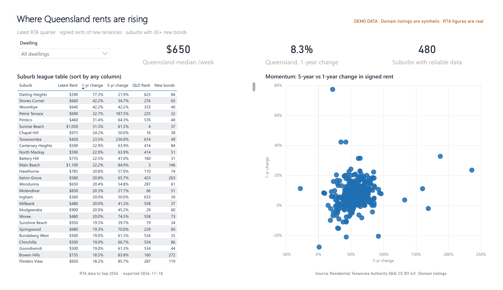
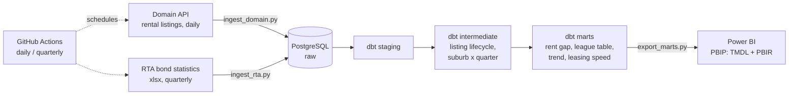
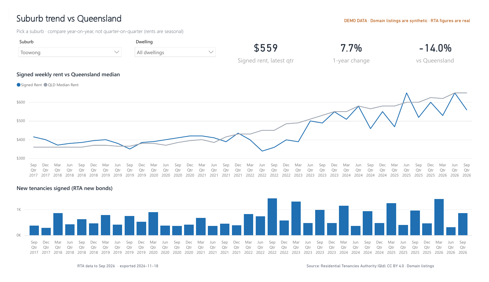

# Brisbane rents: what landlords ask vs what tenants sign

[](https://github.com/hmn3702/brisbane-rent-pipeline/actions/workflows/ci.yml)

An end-to-end data project on the Brisbane rental market. Python pulls in the data, PostgreSQL stores it,
dbt models and tests it, and a Power BI dashboard (kept as code) shows it.

**The question:** Queensland's Residential Tenancies Authority (RTA) publishes the median rent of tenancies
that were *actually signed*. But it only publishes quarterly, about a month after each quarter ends.
Listing sites show what landlords are *asking* today. How far apart are those two numbers in each suburb,
and do suburbs that ask more lease more slowly?



---

## What I found (real RTA data, Sep quarter 2026)

- **Queensland's median weekly rent for new tenancies is $650, up 8.3% on a year earlier.**
- **Headline suburb medians can mislead.** In Toowong, 618 of the 870 new bonds lodged were for dwellings
  RTA classes as "Other". So the suburb's "All dwellings" median ($559) is *lower* than the median for a
  one-bedroom flat ($600). A large share of tenancies near UQ are probably rooms or student accommodation.
  Comparing a suburb's apartment and house listings against that "All dwellings" median would make asking
  rents look far more inflated than they are. The project compares like with like instead, dwelling type
  by dwelling type, and weights by RTA's mix (see *mix-adjusted gap* below).

> **Status:** the asking-rent side (Domain listings API) is waiting on API access approval. Until then,
> pages 3–4 of the dashboard run on **synthetic listings**. These are flagged in the data
> (`"_synthetic": true`), and the dashboard shows a DEMO banner. Every RTA figure above is real.

## Architecture



| Layer | Tools |
|---|---|
| Ingestion | Python (requests, openpyxl), OAuth client credentials, retries, idempotent upserts |
| Storage | PostgreSQL: raw JSONB snapshots plus a long-format RTA table (~935k rows) |
| Transformation | dbt Core: 3 layers, 8 models, 22 data tests |
| Testing | 9 pytest tests (API mocked, real-workbook checks) and 22 dbt schema and singular tests |
| BI | Power BI Project (TMDL semantic model + PBIR report), generated from `powerbi/build_pbip.py` |
| CI | GitHub Actions on every push: pytest, then the full pipeline (RTA parser → synthetic listings → `dbt build`) on a fresh Postgres |
| Orchestration | GitHub Actions cron jobs (skip until secrets are configured) |

## Engineering decisions worth a look

**1. Daily snapshots turn a "current listings" API into history.**
Domain's API only returns listings that are live right now. Storing one snapshot per day lets the
`int_domain__listings` model rebuild each listing's lifecycle: first seen, last seen, price cuts, and days on
market. Listings already live on the first snapshot are *left-censored*, because their true start date is
unknown. They are excluded from days-on-market instead of being counted as fast leases.

**2. One parser for a messy 12-sheet workbook, built to fail loudly.**
The RTA workbook has 4 geographies × 3 measures, laid out wide (quarters as columns). `ingest_rta.py`
turns it into a single long table and handles the quirks: a trailing space in one sheet name, `''` vs
`None` for suppressed cells, and suburbs that share a name (`West End (4101)` vs `West End (4810)`). It also
checks the latest quarter against the workbook's own contents page. If RTA changes the layout, the load
stops with an error instead of quietly loading wrong numbers.

**3. As-of join, capped.**
RTA publishes about a month after each quarter ends, so today's asking rents are compared with the latest
RTA quarter available. `rta_quarters_behind` records how stale that comparison is. When RTA suppresses a
small cell, the join is allowed to look back at most 2 quarters (`max_rta_lag_quarters`).

**4. Mix-adjusted gap.**
A suburb's headline gap is the per-dwelling gaps (Flat 1, House 3, …) weighted by RTA's new bonds. It is
not "median of all listings vs median of all bonds", because that compares two different dwelling mixes.

**5. A bug caught by testing the dashboard against SQL.**
I wrote SQL that repeats the logic of each DAX measure and checked the dashboard against it. On the demo data,
Toowong showed 8.5% in dbt but 7.8% in DAX. The cause was the as-of join silently reaching back **6 quarters** whenever RTA
had suppressed a cell. I fixed it with the lookback cap, plus a dbt test
(`assert_mix_adjusted_gap_matches_dax_rule`) that keeps the mart and the Power BI measure on the same rule.

**6. Power BI as code.**
The semantic model (TMDL) and the report (PBIR) are plain text, generated by `powerbi/build_pbip.py` and
validated against Microsoft's published JSON schemas. The dashboard can be diffed, reviewed and rebuilt
like any other code. The measures never add up or average medians: one row in context shows the published
median, and several rows show a weighted average.

## Dashboard

| | |
|---|---|
|  |  |
| **Trend vs Queensland:** a suburb's signed rent against the QLD median since 2017 | **Asking vs signed:** mix-adjusted gap by suburb and dwelling (synthetic listings for now) |
|  | |
| **Leasing speed:** days on market and price cuts (synthetic listings for now) | |

## Repository layout

```
ingest_domain.py, ingest_rta.py   ingestion jobs
sql/                              raw-layer DDL
dbt/                              staging → intermediate → marts, tests, macros
config/suburbs.csv                tracked suburbs + Domain↔RTA name mapping (also a dbt seed)
scripts/                          mart export for Power BI, synthetic-data generator
powerbi/                          PBIP project, generator, DAX, Power Query, build notes
tests/                            pytest
.github/workflows/                daily Domain and quarterly RTA schedules
docs/RUNBOOK.md                   setup and run instructions for every stage
```

## Run it

See **[docs/RUNBOOK.md](docs/RUNBOOK.md)**. Short version:

```bash
pip install -r requirements.txt
psql "$DATABASE_URL" -f sql/001_raw_schema.sql -f sql/002_rta_schema.sql
python ingest_rta.py --download                        # real RTA data
python scripts/generate_fake_domain.py --truncate      # synthetic listings until Domain access is granted
cd dbt && dbt build --profiles-dir . && cd ..
python scripts/export_marts.py                         # then open powerbi/pbip/RentDashboard.pbip and Refresh
```

## Data sources and attribution

- **Residential Tenancies Authority (Qld): median rents and bond statistics.** © State of Queensland,
  licensed under [CC BY 4.0](https://creativecommons.org/licenses/by/4.0/). Raw files are not committed;
  `ingest_rta.py --download` fetches them.
- **Domain Group listings API** (pending access). Only aggregated statistics will be published. Raw
  listings, addresses, photos and agent details are never stored in this repository.

---

Built by **Minh Nghia Ha**, Master of IT (Data Science) student at QUT.
